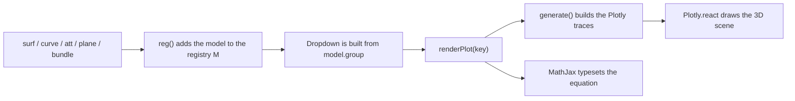

# math-plots

<div align="center">

# 📐 VisualMath

**An interactive 3D gallery of surfaces, probability distributions, engineering curves, knots and chaotic attractors.**

Explore 110 mathematical models in your browser, then reproduce every one of them in Python.


[Quick start](#quick-start) · [Catalogue](#the-catalogue) · [Python library](#python-library) · [Add your own](#add-your-own-models) · [Troubleshooting](#troubleshooting)

</div>

---

## Table of contents

1. [What is VisualMath?](#what-is-visualmath)
2. [Project structure](#project-structure)
3. [Quick start](#quick-start)
4. [Using the web app](#using-the-web-app)
5. [The catalogue](#the-catalogue)
6. [Python library](#python-library)
7. [How the web app works](#how-the-web-app-works)
8. [Add your own models](#add-your-own-models)
9. [Customise the look](#customise-the-look)
10. [Tech stack](#tech-stack)
11. [Good to know](#good-to-know)
12. [Troubleshooting](#troubleshooting)
13. [License](#license)

---

## What is VisualMath?

VisualMath has two halves that share the same catalogue of models:

| | **Web app** | **Python library** |
|---|---|---|
| **Files** | `index.html`, `style.css`, `script.js` | `python/math_functions.py` |
| **Built with** | Plotly.js, MathJax, plain JavaScript | NumPy, SciPy, Matplotlib |
| **Best for** | Exploring: rotate, zoom, read the equation and the story behind each model | Reusing: tweak parameters, save figures, drop plots into reports and notebooks |
| **Setup** | None. Open the page. | `pip install numpy scipy matplotlib` |

**Highlights**

- 🎛️ **110 models** in 8 categories, from a simple saddle to a 14-tooth involute gear.
- 🧮 **Typeset equations** for every model, rendered with MathJax.
- 🖱️ **Fully interactive 3D**: drag to rotate, scroll to zoom, step through models with the arrow keys.
- 🎨 **A designed interface** with a dark indigo and brass theme, a drafting-grid stage and a layout that adapts to phones.
- 🐍 **One-to-one Python twin**: every web model has a Python method with the same name and documented parameters.
- 📦 **Zero build step**: the web app is three static files.

---

## Project structure

```text
math-plots/
├── index.html            # Page markup, fonts and CDN scripts
├── style.css             # Theme, layout and animations
├── script.js             # Model registry, helpers and UI logic
├── README.md             # You are here
└── python/
    └── math_functions.py # Matplotlib versions of every model
```

---

## Quick start

### Run the web app

The app is static, so there is nothing to install. It loads Plotly, MathJax and the fonts from CDNs, so you need an internet connection the first time.

**Option A: open the file**

Double-click `index.html`. It works in any modern browser with WebGL.

**Option B: serve it locally (recommended)**

From the `math-plots/` folder:

```bash
python3 -m http.server 8000
```

Then visit <http://localhost:8000>.

> [!TIP]
> Prefer Node? `npx serve .` does the same job. In VS Code, the *Live Server* extension also works.

### Run the Python library

```bash
pip install numpy scipy matplotlib
cd python
python math_functions.py        # opens the demo plot (a cycloid)
```

Requires Python 3.8 or newer and Matplotlib 3.6 or newer (needed for equal-aspect 3D axes). It has been tested with Matplotlib 3.10, NumPy 2.4 and SciPy 1.17.

---

## Using the web app

| Control | What it does |
|---|---|
| **Dropdown** | Pick any model. Models are grouped by category. |
| **‹ and ›** | Previous and next model. |
| **⟳** | Jump to a random model. |
| **← and → keys** | Browse without touching the mouse. (Ignored while the dropdown has focus.) |
| **Drag** | Rotate the 3D scene. |
| **Scroll or pinch** | Zoom in and out. |

The sidebar shows the model's **category**, **name**, **equation** and a short **description**. The plot appears in the main stage.

> [!NOTE]
> Flat curves, such as the cycloid or the spur gear, are drawn in the XY plane. Drag the scene until you look straight down on it to see them face-on.

---

## The catalogue

| Category | Models | What you will find |
|---|:--:|---|
| Surfaces | 5 | Sinc ripples, saddles, the egg carton |
| Distributions | 21 | Joint densities, heavy tails, copulas, MCMC test targets and parameter families |
| Optimization Landscapes | 6 | Rastrigin, Rosenbrock, Ackley and other benchmark functions |
| Parametric Surfaces | 11 | Torus, Möbius strip, Klein bottle, minimal surfaces, a seashell |
| 3D Curves & Knots | 6 | Trefoil, torus knot, Lissajous curve, Viviani's curve |
| Engineering Curves | 35 | Cycloids, trochoids, epicycloids, spirals, gear and linkage curves |
| Involutes & Evolutes | 13 | Involute gears and helicoids, evolutes with their normals, offset curves |
| Attractors | 13 | Lorenz, Rössler, Thomas, Halvorsen, Dadras and friends |

Each entry lists the **web key** (used in `script.js`) and the **Python call**. They are the same name on both sides.

<details>
<summary><b>Surfaces (5)</b></summary>

| Model | Python call |
|---|---|
| The Sinc Function | `Surfaces.sinc()` |
| Hyperbolic Paraboloid | `Surfaces.saddle()` |
| Monkey Saddle | `Surfaces.monkey()` |
| Drop-Wave Function | `Surfaces.dropwave()` |
| Egg Carton Surface | `Surfaces.eggcarton()` |

</details>

<details>
<summary><b>Distributions (21)</b></summary>

| Model | Python call |
|---|---|
| Bivariate Gaussian | `Distributions.gaussian()` |
| Correlated Normal (ρ = 0.8) | `Distributions.corrnormal()` |
| Gaussian Mixture | `Distributions.gmm()` |
| Bivariate Skew-Normal | `Distributions.skewnormal()` |
| Bivariate Student's t (ν = 3) | `Distributions.student2d()` |
| Bivariate Cauchy | `Distributions.cauchy2d()` |
| Bivariate Laplace | `Distributions.laplace2d()` |
| Bivariate Logistic (Gumbel) | `Distributions.logistic2d()` |
| Bivariate Log-Normal | `Distributions.lognormal2d()` |
| Normal-Gamma | `Distributions.normalgamma()` |
| Dirichlet (α = 3, 5, 4) | `Distributions.dirichlet()` |
| Bivariate von Mises (torus) | `Distributions.vonmises()` |
| Clayton Copula Density (θ = 2) | `Distributions.clayton()` |
| Banana (Twisted Gaussian) | `Distributions.banana()` |
| Neal's Funnel | `Distributions.funnel()` |
| Gamma Family (shape k) | `Distributions.gammafam()` |
| Beta Family (α, β = 3) | `Distributions.betafam()` |
| Student's t Family (ν) | `Distributions.tfam()` |
| Chi-Squared Family (k) | `Distributions.chisqfam()` |
| Weibull Family (shape k) | `Distributions.weibullfam()` |
| Poisson Family (rate λ) | `Distributions.poissonfam()` |

</details>

<details>
<summary><b>Optimization Landscapes (6)</b></summary>

| Model | Python call |
|---|---|
| Rastrigin Function | `OptimizationLandscapes.rastrigin()` |
| Rosenbrock Valley | `OptimizationLandscapes.rosenbrock()` |
| Ackley Function | `OptimizationLandscapes.ackley()` |
| Himmelblau's Function | `OptimizationLandscapes.himmelblau()` |
| Beale Function | `OptimizationLandscapes.beale()` |
| Cross-in-Tray Function | `OptimizationLandscapes.crossintray()` |

</details>

<details>
<summary><b>Parametric Surfaces (11)</b></summary>

| Model | Python call |
|---|---|
| The Torus | `ParametricSurfaces.torus()` |
| Möbius Strip | `ParametricSurfaces.mobius()` |
| Helicoid | `ParametricSurfaces.helicoid()` |
| Catenoid | `ParametricSurfaces.catenoid()` |
| Enneper Surface | `ParametricSurfaces.enneper()` |
| Parametric Sphere | `ParametricSurfaces.sphere()` |
| Dini's Surface | `ParametricSurfaces.dini()` |
| Steiner's Roman Surface | `ParametricSurfaces.roman()` |
| Figure-8 Klein Bottle | `ParametricSurfaces.klein()` |
| Catalan's Surface | `ParametricSurfaces.catalan()` |
| Seashell | `ParametricSurfaces.seashell()` |

</details>

<details>
<summary><b>3D Curves & Knots (6)</b></summary>

| Model | Python call |
|---|---|
| Trefoil Knot | `CurvesAndKnots.trefoil()` |
| Torus Knot (3,5) | `CurvesAndKnots.torusknot()` |
| 3D Lissajous Curve | `CurvesAndKnots.lissajous3d()` |
| Viviani's Curve | `CurvesAndKnots.viviani()` |
| Spherical Spiral | `CurvesAndKnots.sphspiral()` |
| Conical Spiral | `CurvesAndKnots.conespiral()` |

</details>

<details>
<summary><b>Engineering Curves (35)</b></summary>

| Family | Model | Python call |
|---|---|---|
| Cycloids and trochoids | Cycloid | `EngineeringCurves.cycloid()` |
| | Brachistochrone (Tautochrone) | `EngineeringCurves.brachistochrone()` |
| | Inferior Trochoid (curtate) | `EngineeringCurves.trochoidin()` |
| | Superior Trochoid (prolate) | `EngineeringCurves.trochoidsup()` |
| Epicycloids | Cardioid | `EngineeringCurves.cardioid()` |
| | Nephroid | `EngineeringCurves.nephroid()` |
| | Epicycloid (3 cusps) | `EngineeringCurves.epi3()` |
| | Ranunculoid (5 cusps) | `EngineeringCurves.ranunculoid()` |
| | Inferior Epitrochoid | `EngineeringCurves.epitroin()` |
| | Superior Epitrochoid | `EngineeringCurves.epitrosup()` |
| | Wankel Housing | `EngineeringCurves.wankel()` |
| Hypocycloids | Deltoid (Steiner curve) | `EngineeringCurves.deltoid()` |
| | Astroid | `EngineeringCurves.astroid()` |
| | Hypocycloid (R/r = 5/2) | `EngineeringCurves.hypo52()` |
| | Inferior Hypotrochoid | `EngineeringCurves.hypotroin()` |
| | Superior Hypotrochoid | `EngineeringCurves.hypotrosup()` |
| Spirals | Archimedean Spiral | `EngineeringCurves.archspiral()` |
| | Logarithmic Spiral | `EngineeringCurves.logspiral()` |
| | Fermat's Spiral | `EngineeringCurves.fermat()` |
| | Euler Spiral (Clothoid) | `EngineeringCurves.clothoid()` |
| Gears and mechanisms | Involute of a Circle | `EngineeringCurves.involute()` |
| | Four-Bar Coupler Curve | `EngineeringCurves.fourbar()` |
| | Slider-Crank Piston Motion | `EngineeringCurves.slidercrank()` |
| | Limaçon | `EngineeringCurves.limacon()` |
| Structures and dynamics | Catenary | `EngineeringCurves.catenary()` |
| | Tractrix | `EngineeringCurves.tractrix()` |
| | Damped Oscillation | `EngineeringCurves.damped()` |
| | Beat Pattern | `EngineeringCurves.beats()` |
| | Lissajous Figure (5:4) | `EngineeringCurves.lissajous2d()` |
| | Superellipse (n = 4) | `EngineeringCurves.superellipse()` |
| Classical curves | Lemniscate of Bernoulli | `EngineeringCurves.lemniscate()` |
| | Witch of Agnesi | `EngineeringCurves.witch()` |
| | Cissoid of Diocles | `EngineeringCurves.cissoid()` |
| | Rose Curve (k = 5/2) | `EngineeringCurves.rose52()` |
| | Butterfly Curve | `EngineeringCurves.butterfly()` |

</details>

<details>
<summary><b>Involutes & Evolutes (13)</b></summary>

| Model | Python call |
|---|---|
| Involute Family of a Circle | `InvolutesEvolutes.invfamily()` |
| Involute Spur Gear (14 teeth) | `InvolutesEvolutes.spurgear()` |
| Involutes of an Ellipse | `InvolutesEvolutes.invellipse()` |
| Involute of a Parabola | `InvolutesEvolutes.invparabola()` |
| Involute of a Cycloid | `InvolutesEvolutes.invcycloid()` |
| Involute of a Catenary (Tractrix) | `InvolutesEvolutes.invcatenary()` |
| Involute Helicoid (helical gear flank) | `InvolutesEvolutes.invhelicoid()` |
| Parallel Curves of an Ellipse | `InvolutesEvolutes.ellipseoffsets()` |
| Parabola and its Evolute | `InvolutesEvolutes.evparabola()` |
| Ellipse and its Evolute | `InvolutesEvolutes.evellipse()` |
| Cycloid and its Evolute | `InvolutesEvolutes.evcycloid()` |
| Catenary and its Evolute | `InvolutesEvolutes.evcatenary()` |
| Astroid and its Evolute | `InvolutesEvolutes.evastroid()` |

</details>

<details>
<summary><b>Attractors (13)</b></summary>

| Model | Python call |
|---|---|
| Lorenz Attractor | `Attractors.lorenz()` |
| Rössler Attractor | `Attractors.rossler()` |
| Chen Attractor | `Attractors.chen()` |
| Thomas' Cyclically Symmetric Attractor | `Attractors.thomas()` |
| Halvorsen Attractor | `Attractors.halvorsen()` |
| Aizawa Attractor | `Attractors.aizawa()` |
| Rabinovich-Fabrikant | `Attractors.rabinovich()` |
| Lorenz-84 Attractor | `Attractors.lorenz84()` |
| Sprott System A | `Attractors.sprottA()` |
| Nosé-Hoover Attractor | `Attractors.nosehoover()` |
| Burke-Shaw Attractor | `Attractors.burkeshaw()` |
| Dadras Attractor | `Attractors.dadras()` |
| Four-Wing Attractor | `Attractors.fourwing()` |

</details>

---

## Python library

`python/math_functions.py` groups the models into eight classes. Every method is a `@staticmethod`, takes only optional keyword arguments, and **returns a Matplotlib `Figure`**, so you decide whether to show it, save it or embed it.

| Class | Models | Typical parameters |
|---|:--:|---|
| `Surfaces` | 5 | `x_min`, `x_max`, `y_min`, `y_max`, `step` |
| `Distributions` | 21 | grid bounds and `step`, or per-axis `x_step`, `k_step` and so on |
| `OptimizationLandscapes` | 6 | grid bounds and `step` |
| `ParametricSurfaces` | 11 | `u_steps`, `v_steps` |
| `CurvesAndKnots` | 6 | `t_max`, `dt` |
| `EngineeringCurves` | 35 | `t_max`, `dt` and curve constants such as `r` or `d` |
| `InvolutesEvolutes` | 13 | mostly none, a few take counts and step sizes |
| `Attractors` | 13 | `steps`, `dt`, `init_state` |

### Basic usage

Run these from inside the `python/` folder, or add it to your `PYTHONPATH`.

```python
import matplotlib.pyplot as plt
from math_functions import Attractors

fig = Attractors.lorenz()                       # defaults
fig.savefig("lorenz.png", dpi=200, bbox_inches="tight")
plt.show()                                      # interactive window: drag to rotate
```

### Change the parameters

```python
from math_functions import Attractors, Distributions, EngineeringCurves

Attractors.lorenz(steps=20000, dt=0.004, init_state=(1.0, 1.0, 1.0))
Distributions.gmm(x_min=-6, x_max=6, y_min=-6, y_max=6, step=0.05)   # finer grid
EngineeringCurves.cycloid(t_max=10 * 3.14159, r=2)
```

### Read the documentation

Every method has a docstring that lists its inputs and the output. Most also describe real-life applications.

```python
from math_functions import Attractors
help(Attractors.lorenz)
```

### Export the whole catalogue

This renders every model to a PNG without opening any windows. A model that raises an error is skipped and reported, so one failure does not stop the run.

```python
import inspect
from pathlib import Path

import matplotlib
matplotlib.use("Agg")                  # write files only, no GUI
import matplotlib.pyplot as plt
import math_functions as mf

out = Path("gallery")
out.mkdir(exist_ok=True)

classes = ("Surfaces", "Distributions", "OptimizationLandscapes", "ParametricSurfaces",
           "Attractors", "CurvesAndKnots", "EngineeringCurves", "InvolutesEvolutes")

for cls_name in classes:
    cls = getattr(mf, cls_name)
    for name, fn in inspect.getmembers(cls, inspect.isfunction):
        if name.startswith("_"):
            continue                   # skip private helpers
        try:
            fig = fn()
            fig.savefig(out / f"{cls_name}_{name}.png", dpi=150, bbox_inches="tight")
            plt.close(fig)
        except Exception as err:
            print(f"skipped {cls_name}.{name}: {err}")
```

### Use it in a notebook

```python
%matplotlib widget        # needs `pip install ipympl`; gives rotatable 3D plots
from math_functions import ParametricSurfaces
ParametricSurfaces.klein()
```

> [!NOTE]
> The web app uses Plotly colour scales such as *Portland* and *Electric*. Matplotlib has no exact twins, so the Python plots use the closest built-in colormaps. Shapes and equations are the same.

---

## How the web app works



**`index.html`** holds the layout: a sidebar (brand, picker, info card, hint) and the plot stage. It loads Plotly 2.27, MathJax 3 and two Google Fonts, then `script.js` last.

**`style.css`** holds the whole visual identity (see [Customise the look](#customise-the-look)) plus the responsive rules for screens under 820 px wide.

**`script.js`** has three layers:

1. **Maths helpers** such as `generateGrid`, `generateParametric`, `generateAttractor` and `polyline`, plus the numeric `involute()` that unwinds any planar curve.
2. **The registry `M`**: every model is one call to a small wrapper that stores its category, name, LaTeX equation, description and a `generate()` function.
3. **UI logic**: builds the dropdown, handles the buttons and arrow keys, then calls `Plotly.react` and re-typesets the equation whenever the model changes.

| Wrapper | Use it for |
|---|---|
| `surf(key, group, name, eq, desc, colorscale, fn)` | Any surface, either `z = f(x, y)` through `G()` / `GR()` or parametric through `P()` |
| `curve(key, group, name, eq, desc, colorscale, width, fn)` | A 3D curve coloured by height |
| `att(key, name, eq, desc, colorscale, steps, dt, init, fn)` | A strange attractor integrated with Euler steps |
| `plane(key, name, eq, desc, colorscale, width, t0, t1, dt, fn)` | A flat curve in the XY plane |
| `bundle(key, name, eq, desc, colorscale, width, curvesFn)` | Several flat curves in one plot, each with its own colour band |

---

## Add your own models

### In the web app

Add a call to `script.js`, placed **next to the other models of the same category** so that the arrow keys step through them in order. A new category appears in the dropdown automatically.

**A surface:**

```js
surf('ripple', 'Surfaces', 'Fading Ripple',
  T`z=\sin(r)\,e^{-r/4},\; r=\sqrt{x^2+y^2}`,       // T`...` keeps LaTeX backslashes intact
  'Concentric waves that die away with distance.',
  'Viridis',
  G(-10, 10, .2, (x, y) => { const r = Math.hypot(x, y); return Math.sin(r) * Math.exp(-r / 4); }));
```

**An attractor:**

```js
att('myattractor', 'My Attractor',
  T`\dot x=y,\; \dot y=-x+yz,\; \dot z=1-y^2`,
  'A tiny chaotic system.',
  'Plasma', 12000, .02, [0, 5, 0],                   // steps, dt, starting point
  (x, y, z) => [y, -x + y * z, 1 - y * y]);          // returns [dx, dy, dz]
```

**A flat engineering curve** (parameter `t` runs from `t0` to `t1`):

```js
plane('mycurve', 'Epicycloid with 7 Cusps', pe('7,1,1'),
  'A circle rolling outside a circle seven times larger.',
  'Rainbow', 6, 0, 2 * Math.PI, .01, epi(7, 1, 1));
```

> [!IMPORTANT]
> Keys must be unique, because a repeated key silently replaces the earlier model.

### In the Python library

Add a static method to the matching class and return the figure:

```python
@staticmethod
def ripple(x_min=-10, x_max=10, y_min=-10, y_max=10, step=0.2):
    """Plots a fading ripple (z = sin(r) * exp(-r/4))."""
    x = np.arange(x_min, x_max, step)
    y = np.arange(y_min, y_max, step)
    X, Y = np.meshgrid(x, y)
    R = np.hypot(X, Y)
    fig = plt.figure(figsize=(10, 7))
    ax = fig.add_subplot(111, projection="3d")
    ax.plot_surface(X, Y, np.sin(R) * np.exp(-R / 4), cmap="viridis", edgecolor="none")
    ax.set_title("Fading Ripple")
    return fig
```

---

## Customise the look

The whole theme is a set of CSS variables at the top of `style.css`. Change them and everything follows.

| Variable | Default | Role |
|---|---|---|
| `--ink` | `#090b1a` | Page background, equation card fill |
| `--panel` | `#11142b` | Sidebar background |
| `--raise` | `#181c3d` | Dropdown and button fill |
| `--line` | `#2a2f5c` | Borders and dividers |
| `--text` | `#ece9f6` | Main text |
| `--mute` | `#9a9fc4` | Secondary text |
| `--brass` | `#f0b862` | Equation colour, focus ring, loader |
| `--iris` | `#8f82ff` | Gradient accents and hover borders |
| `--teal` | `#3fd4c4` | Category badge |

Headings use **Fraunces** and body text uses **Instrument Sans**, both from Google Fonts. To change them, edit the `<link>` in `index.html` and the `font` rules in `style.css`. If the fonts are blocked, the app falls back to Georgia and the system sans-serif.

---

## Tech stack

| Layer | Library | Used for |
|---|---|---|
| Web | [Plotly.js 2.27](https://plotly.com/javascript/) | 3D surfaces and lines (WebGL) |
| Web | [MathJax 3](https://www.mathjax.org/) (`tex-svg`) | Typeset LaTeX equations |
| Web | [Google Fonts](https://fonts.google.com/) | Fraunces and Instrument Sans |
| Python | [NumPy](https://numpy.org/) | Grids and vectorised maths |
| Python | [SciPy](https://scipy.org/) | `special` (erf, gammaln, Fresnel integrals) and `integrate.odeint` for attractors |
| Python | [Matplotlib](https://matplotlib.org/) | 3D plotting with `mplot3d` |

---

## Good to know

- **Capped heights.** Beale and the Clayton copula are clipped (at 200 and 20) so their flat regions stay visible.
- **Gaps are intentional.** The Dirichlet surface is drawn only over the triangle of valid probabilities, so the other half of the grid is empty.
- **Poisson is smoothed.** The real distribution lives on whole numbers. The surface uses the Gamma function to extend it continuously.
- **Unnormalised density.** The bivariate von Mises plot is shown without its normalising constant.
- **Attractors use simple Euler steps** in the browser, which is fast and good enough for pictures. The Python version integrates with `scipy.integrate.odeint`.
- **Chaos is sensitive.** Change an initial condition slightly and an attractor's trajectory will look different, though its overall shape stays the same.

---

## Troubleshooting

| Symptom | Likely cause and fix |
|---|---|
| The spinner never goes away, or the plot area is empty | Open the browser console (`F12`) and read the first red error. Make sure WebGL is on (enable hardware acceleration) and that the Plotly script loaded. |
| Equations appear as raw `$$ ... $$` text | MathJax was blocked or is still loading. Check your connection and any content blockers, then reload. |
| Fonts look plain | Google Fonts did not load. The fallback fonts are used. This is harmless. |
| The page works online but not offline | Plotly, MathJax and the fonts come from CDNs. Download them and point the `<script>` and `<link>` tags to local copies. |
| A model looks like a thin line | It is a flat curve seen edge-on. Rotate the view to look straight down at it. |
| `ModuleNotFoundError: scipy` (or `numpy`, `matplotlib`) | Run `pip install numpy scipy matplotlib`. |
| A figure window does not open on a server | Use a non-GUI backend (`matplotlib.use("Agg")`) and save the figure with `fig.savefig(...)`. |
| `set_aspect` raises an error on 3D axes | Upgrade Matplotlib to 3.6 or newer: `pip install -U matplotlib`. |

---

## License

No license file is included yet. Add a `LICENSE` file (for example MIT) before you share the project publicly, so that others know how they may use it.
